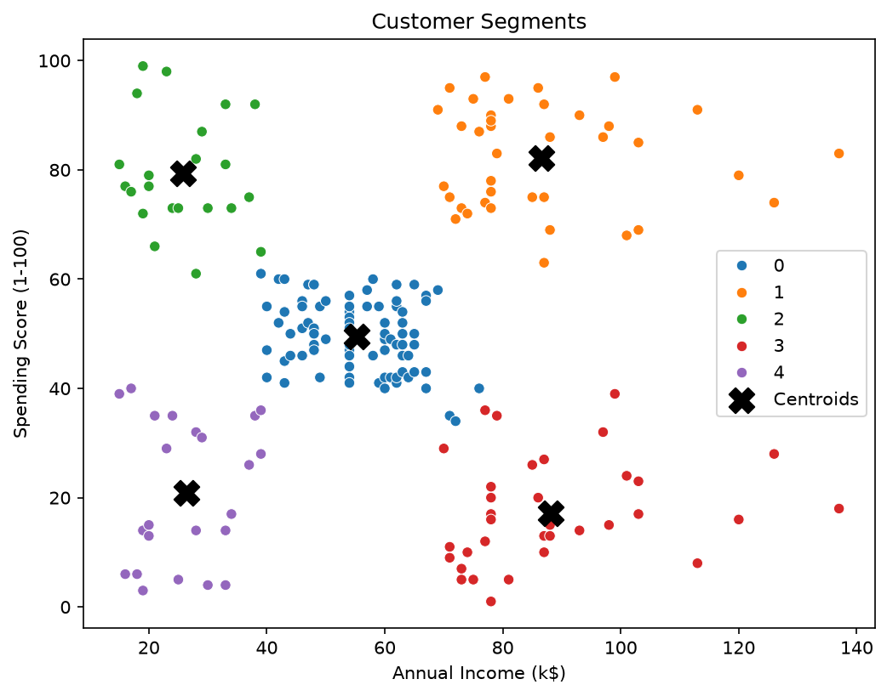

# Customer Segmentation with K-Means

Grouping mall customers into segments using K-Means clustering,
to support targeted marketing decisions.

## Dataset
Mall Customers dataset (200 customers) with columns:
CustomerID, Gender, Age, Annual Income (k$), Spending Score (1-100).

## Method
1. Exploratory data analysis (distributions, missing values)
2. Feature selection: Annual Income and Spending Score
3. Scaling with StandardScaler
4. Choosing k with the Elbow method and Silhouette score (k = 5)
5. Training K-Means and interpreting each cluster

## Results

| Segment | Customers | Avg Age | Avg Income (k$) | Avg Spending |
|---|---|---|---|---|
| Standard | 81 | 42.7 | 55.3 | 49.5 |
| Premium Target | 39 | 32.7 | 86.5 | 82.1 |
| Careful Savers | 35 | 41.1 | 88.2 | 17.1 |
| Budget Conscious | 23 | 45.2 | 26.3 | 20.9 |
| Young Spenders | 22 | 25.3 | 25.7 | 79.4 |

## Project structure
data/        raw dataset
notebooks/   analysis notebook
outputs/     clustered data and figures
## How to run
bash
pip install pandas scikit-learn matplotlib seaborn jupyter
jupyter notebook notebooks/01_eda_clustering.ipynb
## Tools
Python, pandas, scikit-learn, matplotlib, seaborn